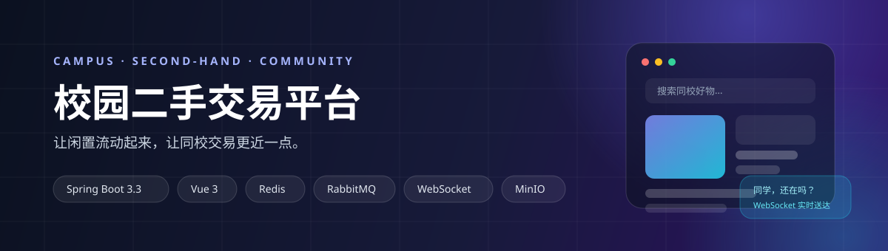
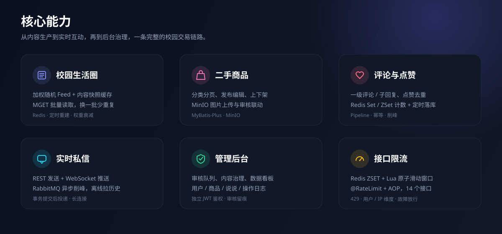
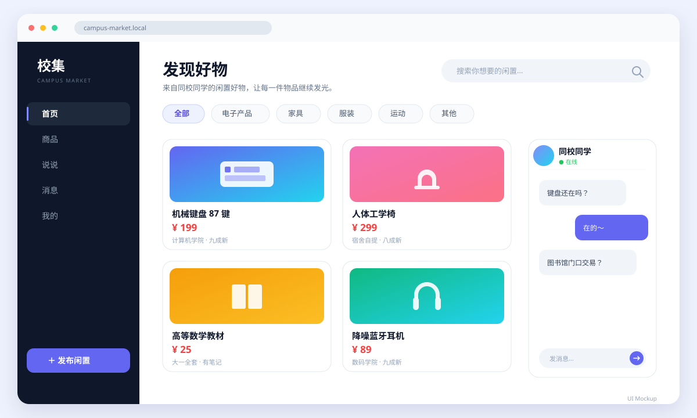
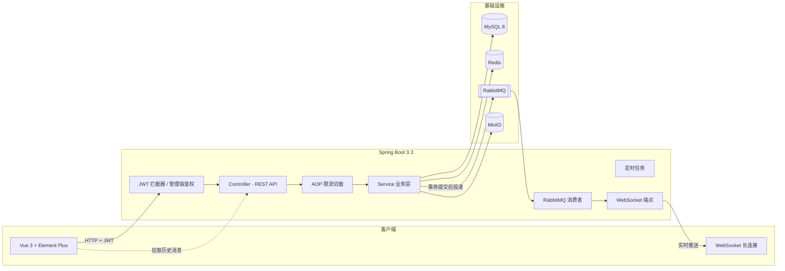
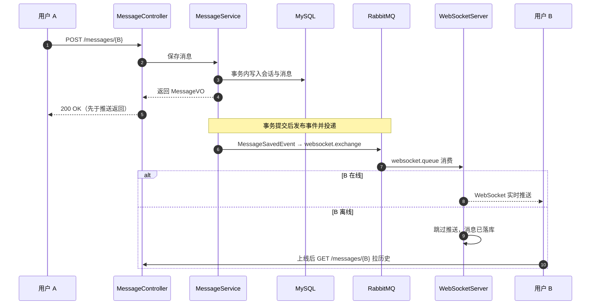

<div align="center">
  
  <br/><br/>

  
  
  
  
  
  
  
  

  <h3>让闲置流动起来，让同校交易更近一点。</h3>
  <p align="center">
    一个面向校园场景的二手交易与生活圈平台：发闲置、逛好物、发说说、聊私信，<br/>
    用一套 Spring Boot 后端把缓存、消息队列、实时推送与接口限流串成完整的业务链路。
  </p>
</div>

---

## 项目简介

**校园二手交易平台**面向高校内的闲置交易与校园社交场景。学生可以发布二手商品、在校园生活圈里发说说、评论点赞、私信聊天；管理员可以在后台完成内容审核、用户管理与运营查看。

项目采用**前后端分离**架构：后端以 Spring Boot 3 为核心，前端使用 Vue 3 + Element Plus。除了常规 CRUD，项目重点打磨了四条工程链路：

- **读得快**：Redis 随机页 + 内容快照缓存，让首页 Feed 在正常路径上几乎不查数据库；
- **写得稳**：点赞用 Redis 去重计数、定时落库，私信用事务事件 + RabbitMQ 异步推送；
- **聊得通**：WebSocket 长连接负责服务端主动推送，离线消息由 REST 历史记录兜底；
- **扛得住**：Redis ZSET + Lua 原子滑动窗口 + `@RateLimit` 注解，对登录、发帖、点赞、私信等 14 个写接口做接口级限流。

## 核心能力



| 模块 | 能力 |
|---|---|
| 校园生活圈 | 加权随机 Feed、Redis 随机页与单条快照缓存、MGET 批量读取、换一批尽量不重复 |
| 二手商品 | 分类与分页、发布/编辑/删除、商品状态管理、MinIO 图片上传 |
| 评论互动 | 一级评论、子评论/回复、删除评论、评论点赞计数 |
| 点赞系统 | Redis Set 去重、ZSet 计数、Pipeline 批量提交，定时任务异步落库 |
| 实时私信 | REST 发送 + WebSocket 推送，事务提交后经 RabbitMQ 异步投递，离线拉历史兜底 |
| 管理后台 | 独立 JWT 鉴权、数据看板、用户/商品/说说管理、审核队列、操作日志 |
| 接口限流 | `@RateLimit` + AOP + Redis ZSET/Lua 滑动窗口，支持用户/IP 维度，超限 429，故障放行 |
| 身份认证 | JWT + HandlerInterceptor + ThreadLocal，C 端与管理端鉴权隔离 |

## 界面示意



> 上图为界面示意（UI Mockup），用于展示首页商品流与实时私信布局；实际页面以运行效果为准。

<!--
有真实截图时，建议放在 docs/images/ 下，并把示意替换为：


-->

## 技术架构



### 一条私信的完整链路



## 技术栈

### 后端

| 技术 | 版本 | 用途 |
|---|---|---|
| Java | 17 | 语言版本 |
| Spring Boot | 3.3.10 | 基础框架、自动配置 |
| Spring MVC | Starter Web | REST 接口 |
| Spring AOP | Starter AOP | `@RateLimit` 限流切面 |
| MyBatis-Plus | 3.5.6 | ORM、分页、链式查询 |
| MySQL | 8.0+ | 业务数据存储（驱动 9.6.0） |
| Redis | 6.0+ | Feed 缓存、点赞、分布式锁、限流 |
| RabbitMQ | 3.x | 私信异步推送、削峰 |
| WebSocket | JSR-356 | 服务端实时推送 |
| JJWT | 0.13.0 | JWT 生成与校验 |
| MinIO | 8.5.17 | 图片对象存储 |
| Hutool | 5.8.44 | JSON、随机数等工具 |
| springdoc-openapi | 2.6.0 | Swagger / OpenAPI 文档 |
| Lombok | — | 简化样板代码 |

### 前端

| 技术 | 版本 |
|---|---|
| Vue | 3.2 |
| Vue Router | 4.1 |
| Pinia | 2.0 |
| Element Plus | 2.2 |
| Axios | 1.3 |
| Vite | 3.2 |

## 目录结构

```text
secondhand_project/
├── src/main/java/com/example/secondhand_project/
│   ├── admin/            # 管理后台：独立鉴权、审核队列、运营管理
│   ├── annotation/       # @RateLimit 限流注解
│   ├── aspect/           # 限流切面（身份解析、Lua 调用、fail-open）
│   ├── conf/             # Web、JWT、MyBatis-Plus、MinIO、WebSocket 配置
│   ├── constants/        # Redis key 常量
│   ├── context/          # BaseContext（ThreadLocal 当前用户）
│   ├── controller/       # C 端 REST 接口
│   ├── enums/            # 业务枚举（点赞类型、限流维度）
│   ├── event/            # Spring 事件（消息保存后投递）
│   ├── exception/ handler/# 业务异常与统一异常处理
│   ├── interceptor/      # JWT 登录拦截器
│   ├── job/              # Feed 池重建、点赞计数落库
│   ├── listener/         # RabbitMQ 消费者
│   ├── mapper/ pojo/     # 实体、DTO、VO、Mapper
│   ├── service/          # 业务服务
│   ├── util/             # JWT、Redis 锁、客户端 IP 解析
│   └── websocketserver/  # WebSocket 推送端点
├── src/main/resources/
│   ├── application.yml   # 数据源、Redis、RabbitMQ、MinIO、限流配置
│   ├── lua/rate_limit.lua# 滑动窗口原子脚本
│   └── mapper/           # MyBatis XML
├── src/test/java/        # 限流、IP 解析、异常处理单元测试
├── docs/
│   ├── images/           # README 配图
│   └── sql/              # 数据库初始化与增量脚本
└── pom.xml
```

> 前端为独立的 Vue 3 + Vite 工程，不在本仓库目录内；接口通过 `/api` 与 `/ws/` 代理到后端。

## 快速开始

### 1. 环境要求

| 组件 | 推荐版本 | 说明 |
|---|---|---|
| JDK | 17+ | 项目以 Java 17 编译 |
| Maven | 3.9+ | 依赖管理与构建 |
| MySQL | 8.0+ | 业务数据 |
| Redis | 6.0+（7.x 亦可） | 缓存、点赞、限流 |
| RabbitMQ | 3.9+ | 私信异步推送 |
| MinIO | 最新稳定版 | 图片对象存储 |
| Node.js | 16+（可选） | 仅重新构建前端时需要 |

### 2. 初始化数据库

```bash
# 1) 建库、建基础表、写入分类数据
mysql -uroot -p < docs/sql/init.sql

# 2) 按时间顺序执行增量脚本
mysql -uroot -p secondhand_market < docs/sql/2026-11-04-like-count.sql
mysql -uroot -p secondhand_market < docs/sql/2026-11-05-comment-feature.sql
mysql -uroot -p secondhand_market < docs/sql/2026-11-09-admin-system.sql

# 3) 可选：导入商品演示数据
mysql -uroot -p secondhand_market < docs/sql/2026-11-16-product-seed-data.sql
```

### 3. 启动中间件

可以用本机服务，也可以用 Docker：

```bash
# MySQL
docker run -d --name market-mysql -p 3306:3306 \
  -e MYSQL_ROOT_PASSWORD=123456 mysql:8.0

# Redis（密码 123456）
docker run -d --name market-redis -p 6379:6379 \
  redis:7-alpine redis-server --requirepass 123456

# RabbitMQ（管理台 http://localhost:15672）
docker run -d --name market-rabbitmq -p 5672:5672 -p 15672:15672 \
  rabbitmq:3.13-management

# 创建项目使用的 vhost 和用户
docker exec -it market-rabbitmq rabbitmqctl add_vhost /hmall
docker exec -it market-rabbitmq rabbitmqctl add_user hmall2 123321
docker exec -it market-rabbitmq rabbitmqctl set_permissions -p /hmall hmall2 ".*" ".*" ".*"

# MinIO（控制台 http://localhost:9001）
docker run -d --name market-minio -p 9000:9000 -p 9001:9001 \
  -e MINIO_ROOT_USER=minioadmin -e MINIO_ROOT_PASSWORD=minioadmin \
  minio/minio server /data --console-address ":9001"
```

> MinIO 启动后，请在控制台创建桶 `liuzhuanpin`，并按需设置公开读；也可以在 `application.yml` 中用环境变量覆盖账号、桶名和访问地址。

### 4. 修改配置

配置文件：`src/main/resources/application.yml`

```yaml
server:
  port: 8081

spring:
  datasource:
    url: jdbc:mysql://localhost:3306/secondhand_market
    username: root
    password: 123456
  data:
    redis:
      host: localhost
      port: 6379
      database: 1
      password: 123456
  rabbitmq:
    host: localhost
    port: 5672
    virtual-host: /hmall
    username: hmall2
    password: 123321

secondhand:
  jwt:
    secret-key: wangkaiweiwangkaiweiwangkaiweiwangkaiwei
    ttl-mills: 17000000
    user-token-name: Authorization
  minio:
    enabled: ${MINIO_ENABLED:true}
    endpoint: ${MINIO_ENDPOINT:http://localhost:9000}
    access-key: ${MINIO_ACCESS_KEY:...}
    secret-key: ${MINIO_SECRET_KEY:...}
    bucket: ${MINIO_BUCKET:liuzhuanpin}

rate-limit:
  enabled: true
```

> 仓库中的数据库、Redis、RabbitMQ 密码为**本地开发示例**。部署到公网前请改为环境变量或配置中心，并立即轮换真实凭据。

### 5. 启动后端

```bash
# 开发模式
mvn spring-boot:run

# 或打包后运行
mvn clean package -DskipTests
java -jar target/secondhand_project-0.0.1-SNAPSHOT.jar
```

启动成功后：

- REST API：`http://localhost:8081`
- Swagger UI：`http://localhost:8081/swagger-ui.html`
- OpenAPI JSON：`http://localhost:8081/v3/api-docs`

### 6. 前端

前端为独立的 Vue 3 + Vite 工程，接口通过 `/api` 代理到 `http://localhost:8081`，WebSocket 通过 `/ws/` 代理到同一端口。构建产物可直接部署到 Nginx 或任意静态服务器。

## 接口限流实现

限流能力通过注解接入，业务代码零侵入：

```java
@RateLimit(count = 10, window = 60,
        key = "auth:login",
        dimension = RateLimitDimension.IP,
        message = "登录尝试过于频繁，请稍后再试")
@PostMapping("/login")
public Result login(@RequestBody LoginDTO loginDTO) {
    // ...
}
```

### Redis key 设计

```text
rate_limit:{接口标识}:{身份标识}

# 登录用户
rate_limit:post:create:u:42
# 匿名请求 / 登录接口
rate_limit:auth:login:ip:203.0.113.99
```

- ZSET 的 `score` 存请求毫秒时间戳，`member` 存 `时间戳:UUID`；
- Lua 脚本一次性完成「清理窗口外记录 → 窗口计数 → 写入本次请求 → 续期」，避免并发超发；
- Redis 故障时记录 `warn` 日志并放行（fail-open），避免限流组件放大故障；
- 超限统一返回 `HTTP 429`，响应体保持项目统一的 `Result` 结构。

### 已接入的接口

| 接口 | 阈值 | 维度 |
|---|---|---|
| `POST /auth/login` | 10 次 / 60 秒 | IP |
| `POST /auth/register` | 5 次 / 5 分钟 | IP |
| `POST /admin/auth/login` | 5 次 / 60 秒 | IP |
| `POST /posts` | 5 次 / 60 秒 | 用户 / IP |
| `DELETE /posts/{id}` | 10 次 / 60 秒 | 用户 / IP |
| `POST /posts/{postId}/comments` | 10 次 / 60 秒 | 用户 / IP |
| `POST /comments/{commentId}/replies` | 15 次 / 60 秒 | 用户 / IP |
| `POST /likes` | 30 次 / 60 秒 | 用户 / IP |
| `POST /messages/{userId}` | 30 次 / 60 秒 | 用户 / IP |
| `POST /products` | 5 次 / 60 秒 | 用户 / IP |
| `PUT /products/{id}` | 10 次 / 60 秒 | 用户 / IP |
| `DELETE /products/{id}` | 10 次 / 60 秒 | 用户 / IP |
| `POST /upload` | 10 次 / 60 秒 | 用户 / IP |
| `PUT /user/profile` | 5 次 / 60 秒 | 用户 / IP |

调试或压测时可以关闭限流：

```yaml
rate-limit:
  enabled: false
```

## 核心设计说明

### 校园 Feed：加权随机 + 快照缓存

`FeedPoolServiceImpl` 定时把候选说说 ID 打散成多张随机页写入 Redis Hash；`FeedServiceImpl` 读取随机页后按 ID 批量 `MGET` 内容快照，正常路径不查数据库。权重由时间衰减、点赞数、新帖加成共同决定，既保证新内容有曝光，也避免爆款长期霸屏。

### 点赞：Redis 先去重，再异步落库

点赞关系用 Redis Set 去重，业务对象的点赞数用 ZSet 维护；批量查询走 Pipeline 减少网络往返，定时任务把增量计数同步到 MySQL。重复点赞/取消点赞保持幂等。

### 私信：事务之后才投递

消息保存使用 `@Transactional`；事务提交成功后通过 `@TransactionalEventListener(AFTER_COMMIT)` 投递 RabbitMQ，消费者再调用 WebSocket 推送。这样不会出现「对方收到消息，但数据库里没有」的脏数据；接收方离线时消息已落库，上线后通过 REST 历史记录兜底。

## 常见问题

**1. 启动时报 RabbitMQ vhost 不存在**
需要创建 `/hmall` 虚拟主机和 `hmall2` 用户，并授权：

```bash
rabbitmqctl add_vhost /hmall
rabbitmqctl add_user hmall2 123321
rabbitmqctl set_permissions -p /hmall hmall2 ".*" ".*" ".*"
```

**2. 图片上传成功但访问 403**
检查 MinIO 桶 `liuzhuanpin` 是否存在，以及是否开启了公开读，或在配置中调整 `minio.public-read`。

**3. 接口返回 429**
说明触发了限流，可以等待窗口结束后重试；本地调试可把 `rate-limit.enabled` 改为 `false`，或清理 Redis 中 `rate_limit:*` 的 key。

**4. 8081 端口被占用**
修改 `application.yml` 中的 `server.port`，同时同步调整前端代理地址。

## 说明

本项目主要用于学习、课程实践与求职展示。仓库中的账号密码、JWT 密钥、MinIO 配置均为本地示例，请勿直接用于生产环境；真实部署时请改为环境变量或配置中心，并做好密钥轮换与访问控制。
